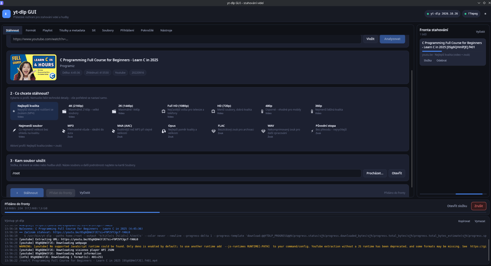
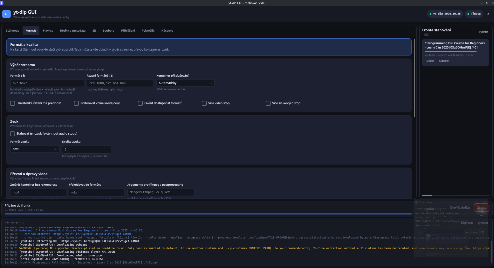
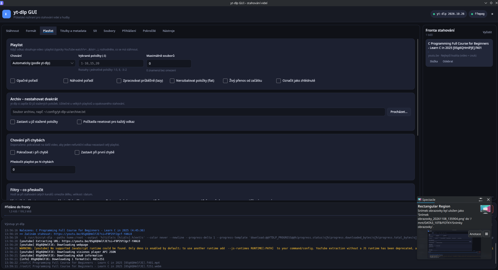
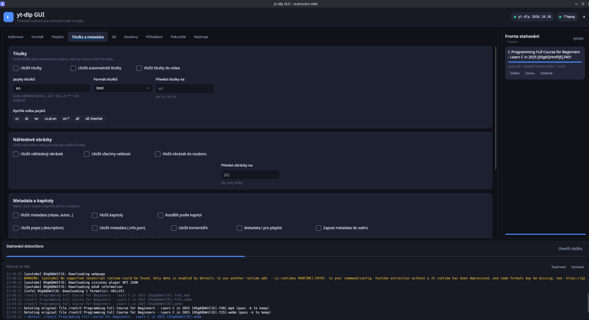
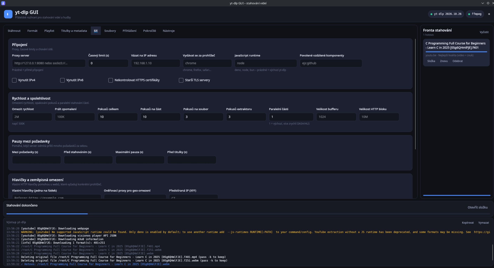
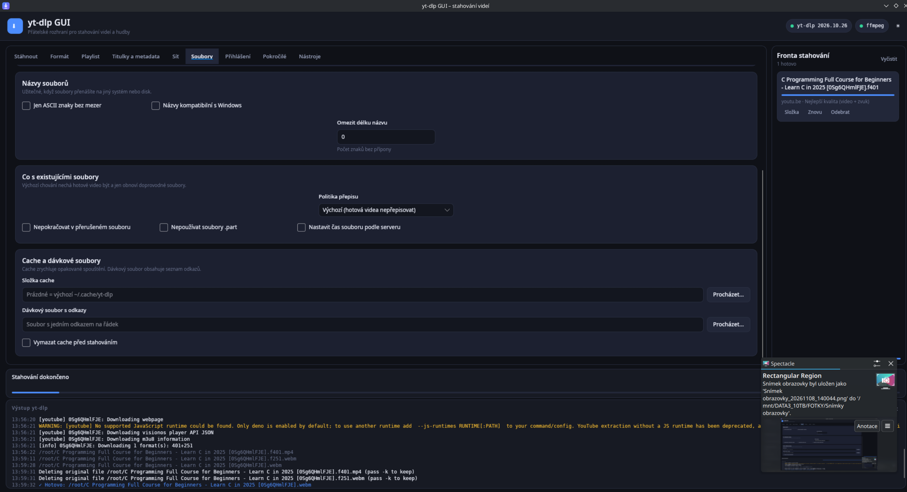
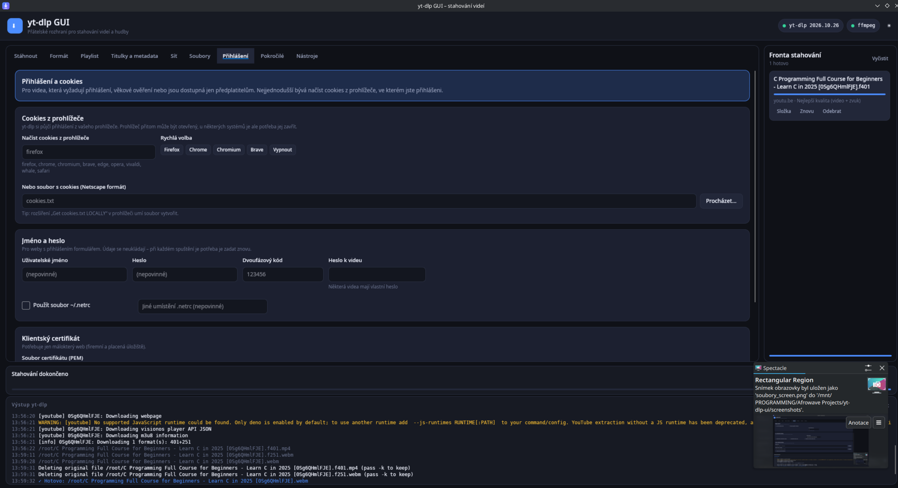
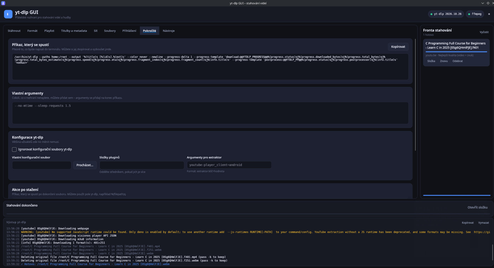
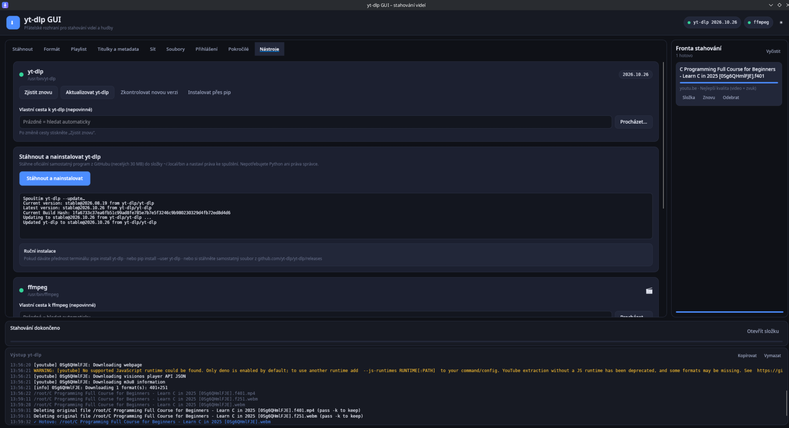

# yt-dlp GUI

Přívětivé **multiplatformní grafické rozhraní pro [yt-dlp](https://github.com/yt-dlp/yt-dlp)** vytvořené v [Avalonia UI](https://avaloniaui.net/) a .NET 10. Stačí vložit odkaz na video nebo playlist, vybrat profil a spravovat stahování bez memorování přepínačů příkazové řádky. Pokročilé volby yt-dlp přitom zůstávají dostupné.

**Stav vydání:** **[v0.1.7 – oprava instalátorů](https://github.com/afrowaveltd/yt-dlp-ui/releases/tag/v0.1.7)** je dostupné pro Windows x64 a Linux x64. Jde o komunitní pre-release; uvítáme zpětnou vazbu a hlášení chyb.

**Dokumentace:** [English](en.md) · Česky (tato stránka) · [Rozcestník](../Documentation/cs.md) · [Documentation index](../Documentation/en.md)

## Co aplikace umí

- **Jednoduché stahování:** načítání odkazů ze schránky, přetažení odkazu, analýza videí a playlistů, náhledy, předvolby kvality (až 4K), pouze zvuk, fronta a průběh.
- **Devět karet:** Stáhnout, Formát, Playlist, Titulky a metadata, Síť, Soubory, Přihlášení, Pokročilé a Nástroje.
- **Pokročilé funkce:** výběr formátu, převody, titulky, metadata, filtry, proxy, šablony názvů, cookies a přihlášení, náhled příkazu yt-dlp.
- **Externí nástroje:** detekce a aktualizace yt-dlp, zjištění FFmpeg a vyhledání JS prostředí Deno; Windows setup nabízí SHA-256 ověřenou instalaci yt-dlp, FFmpeg i Deno.
- **Jazyky:** výběr vpravo nahoře u stavu nástrojů. Anglický a český slovník, automatické načítání `Locales/*.json`, okamžitý přepínač a anglický fallback.
- **Distribuce:** Windows x64 `setup.exe` a portable; Linux `.deb`, `.rpm` a přenosný `.tar.gz`.

Část pokročilých karet, zpráv a dialogů dosud obsahuje české texty. **Lokalizace je i ve verzi 0.1.7 jen částečná.** Úspěšné sestavení balíčku ještě neznamená, že byly ručně otestovány všechny scénáře instalace a stahování.

## Opravy ve verzi 0.1.7

- **Windows Setup:** opraveno zpracování kontrolního součtu yt-dlp — soubor se nyní stáhne a čte výslovně jako UTF-8 bez chybné konverze PowerShellu.
- **Deno:** Windows instalátor i uživatelská instalace v Nástrojích podporují oficiální formát `Get-FileHash` pro SHA-256.
- **Bezpečnost:** kontrola SHA-256 od vydavatele zůstává povinná; jiné názvy souborů, algoritmy a nejednoznačné hodnoty jsou odmítnuty.
- Regresní testy i CI Windows/Linux u opravy prošly; instalace všech tří doplňků byla úspěšně ověřena na druhém počítači.

[Poznámky 0.1.7](../Release-0.1.7/cs.md) · [English notes](../Release-0.1.7/en.md)

## Oprava ve verzi 0.1.6

- Opravena chyba, kdy se v playlistu **stále zobrazoval název třídy `MediaEntry`** i po úpravě šablony ve v0.1.5.
- Šablona seznamu se teď použije bez podmínky `DataType`. Záložní text navíc obsahuje **pořadí, název a délku**, i když Avalonia zvolí výchozí zobrazení.
- Přidán **skutečný headless UI test Avalonie**, který načte zkompilovanou kartu Stáhnout a kontroluje zobrazené názvy. Test běží na Windows i Linuxu.

[Poznámky 0.1.6](../Release-0.1.6/cs.md) · [English notes](../Release-0.1.6/en.md)

## Oprava ve verzi 0.1.5

- Opraven seznam videí po analýze playlistu. Místo názvů se dosud zobrazovalo `YtDlpUi.Core.Models.MediaEntry`.
- Položky nyní zobrazují **pořadí, název a dostupnou délku videa**.
- Opraven typ zobrazovací šablony Avalonia z `LogLine` na `MediaEntry` a doplněn regresní smoke test.
- Jde **pouze o zobrazení**; stahování, fronta ani volby formátů se nemění.

[Poznámky 0.1.5](../Release-0.1.5/cs.md) · [English notes](../Release-0.1.5/en.md)

## Změny ve verzi 0.1.4

- Vpravo nahoře je **třetí stavová kontrolka Deno** vedle yt-dlp a FFmpeg. Po najetí myší ukáže nalezenou cestu.
- Na kartě **Nástroje → Deno** je dostupnost, verze a cesta a lze Deno znovu vyhledat nebo **nainstalovat osobní kopii na Windows/Linux** bez administrátorských oprávnění.
- Linux hledá Deno i v `DENO_INSTALL/bin`, `~/.deno/bin` a dalších uživatelských složkách, včetně spuštění aplikace z grafické nabídky.
- Doplněné regresní kontroly Deno v UI a instalační cesty; možnost společné instalace z Windows setupu zůstává zachována.

[Poznámky 0.1.4](../Release-0.1.4/cs.md) · [Nápověda Deno/YouTube](../Troubleshooting/cs.md)

## Opravy ve verzi 0.1.3

- Oprava opakovaného upozornění YouTube na chybějící JavaScript prostředí: GUI automaticky najde místní Deno a předá jeho cestu při analýze i stahování.
- Windows instalátor má **třetí nezávislou výchozí zaškrtnutou položku: instalovat Deno**. Ověří SHA-256 a spustitelnost oficiálního balíčku; Deno nainstaluje společně pro všechny uživatele.
- Ručně zvolený JavaScript runtime v pokročilých nastaveních má přednost. GUI nic automaticky nestahuje bez souhlasu.
- Oficiální samostatný yt-dlp.exe obsahuje již připravené EJS skripty.

[Poznámky 0.1.3](../Release-0.1.3/cs.md) · [Nápověda Deno/YouTube](../Troubleshooting/cs.md)

## Opravy ve verzi 0.1.2

- Windows setup žádá **potvrzení správce (UAC)** a instaluje pro všechny uživatele do Program Files.
- Volitelné yt-dlp a FFmpeg se instalují do `%ProgramData%\yt-dlp-ui\tools` s ověřením SHA-256.
- Běžný uživatel nástroje automaticky najde; nastavení, cache a jazyky má každý vlastní.
- Kontrolujeme i skutečné spuštění doplňků a při chybě zachováváme předchozí instalaci.
- Při přechodu ze starší verze může být potřeba odstranit původní uživatelskou instalaci.

[Podrobnosti 0.1.2](../Release-0.1.2/cs.md) · [Dřívější opravy 0.1.1](../Release-0.1.1/cs.md)

## Opravy ve verzi 0.1.1

- Globus u volby jazyka je nyní vektorový a má vyhrazené místo; na Linuxu se neořezává emoji fontem.
- Každá položka fronty si pamatuje původní formát, složku a přihlašovací volby, i když se změní GUI.
- Instalace yt-dlp kontroluje SHA-256 konkrétního souboru a při chybě zachová funkční předchozí verzi.
- Aktualizace FFmpeg zachová starou instalaci do dokončení výměny.
- Nastavení se ukládá atomicky; vypnutí pamatování voleb vymaže dříve uložený snímek.
- Běžící položku nelze bez zrušení odebrat z fronty; surové příkazy s potenciálními hesly se nezapisují do logu.

Viz [poznámky k opravám](../Release-0.1.4/cs.md). **Android není součástí desktopového vydání.**

## Ukázky

| | |
|---|---|
|  **Formát** |  **Playlist** |
|  **Titulky a metadata** |  **Síť** |
|  **Soubory** |  **Přihlášení** |
|  **Pokročilé** |  **Nástroje** |

Snímky představují stav aplikace při pořízení a nemusí obsahovat nejnovější ovládací prvky. Kliknutím otevřeš plné rozlišení.

## Instalace a spuštění

### Windows 10/11 (x64)

Z [vydání v0.1.7](https://github.com/afrowaveltd/yt-dlp-ui/releases/tag/v0.1.7) stáhni **Windows instalační EXE** a spusť `yt-dlp-gui-setup-0.1.7-win-x64.exe`. Průvodce vytvoří zástupce v nabídce Start, umožní běžnou odinstalaci a nabídne tři **nezávislé, ve výchozím stavu zaškrtnuté** položky: nainstalovat yt-dlp, FFmpeg a Deno (doporučeno pro YouTube). Stahování vyžaduje internet a používá kontrolní součty SHA-256 od vydavatelů. Libovolnou volbu lze vypnout a nástroje doplnit později. Instalátor nyní **žádá administrátorské oprávnění přes UAC** a instaluje program do Program Files pro všechny uživatele. Volitelné yt-dlp, FFmpeg a Deno putují do společného ProgramData a GUI je rozpozná i bez admin práv. Starší instalaci pro jednoho uživatele doporučujeme odinstalovat, aby nevznikly duplicitní zástupci.

V release najdeš i přenosný balíček **`yt-dlp-gui_0.1.7_win-x64_portable.zip`**. Windows ARM64 mají samostatný ruční publish postup, nikoli ověřený instalační program v CI.

### Debian / Ubuntu, Fedora / openSUSE, další Linux

Stáhni odpovídající balíček DEB nebo RPM z [v0.1.7](https://github.com/afrowaveltd/yt-dlp-ui/releases/tag/v0.1.7) a použij správce balíčků distribuce:

~~~bash
sudo apt install ./yt-dlp-gui_0.1.7_amd64.deb    # Debian/Ubuntu x64
sudo dnf install ./yt-dlp-gui-0.1.7-1.x86_64.rpm # Fedora / RPM
~~~

Názvy balíčků se liší podle verze a architektury. DEB/RPM **doporučují** systémové balíčky `yt-dlp` a `ffmpeg`, ale nepřibalují je a nespouštějí skryté skripty pro stahování. Rozhoduje politika správce balíčků. Na jiných distribucích rozbal přenosný `tar.gz` a spusť `./yt-dlp-gui/yt-dlp-gui`. Sestavení obsahují vlastní .NET runtime.

Pro uživatelskou instalaci z kódu je tu `./scripts/install.sh`, odinstalace `./scripts/install.sh --uninstall`.

**v0.1.7 je veřejný, nepodepsaný pre-release.** Podrobnosti najdeš v [Instalaci](../Installation/cs.md).

## Sestavení ze zdrojových kódů

Nainstaluj **.NET 10 SDK** podle `global.json`:

~~~bash
git clone https://github.com/afrowaveltd/yt-dlp-ui.git
cd yt-dlp-ui
dotnet restore YtDlpUi.slnx
dotnet build YtDlpUi.slnx -c Release
dotnet run --project src/YtDlpUi/YtDlpUi.csproj
dotnet run --project tests/YtDlpUi.SmokeTests/YtDlpUi.SmokeTests.csproj -c Release
~~~

Pro samotné stahování je nutný `yt-dlp`; pro spojování a mnoho převodů také `ffmpeg` / `ffprobe`. Na kartě **Nástroje** zjistíš jejich stav a nastavíš vlastní cesty.

## Jak přidat jazyk

Výběr jazyka je **vpravo nahoře** vedle stavu yt-dlp, FFmpeg a Deno. Přepnutí okamžitě změní už lokalizované prvky.

Chceš-li nový jazyk bez překompilování, vytvoř třeba `pt-BR.json` v adresáři:

- Linux: `~/.config/yt-dlp-ui/Locales/` (nebo `$XDG_CONFIG_HOME/yt-dlp-ui/Locales/`)
- Windows: `%LOCALAPPDATA%\yt-dlp-ui\Locales\`
- Případně `Locales/` vedle spustitelného souboru

~~~json
{
  "Download": "Baixar",
  "About": "Sobre"
}
~~~

Při opětovném otevření rozbalovací nabídky se soubory načtou. Názvy souborů odpovídají jazykům (např. `fr.json`, `pt-BR.json`); klíči jsou anglické texty UI. Chybějící nebo prázdné překlady vrací anglický klíč. Uživatelský slovník má přednost před zabaleným. Více: [Lokalizace](../Localization/cs.md).

## Dokumentace

| Téma | Česky | English |
|---|---|---|
| Rozcestník | [Dokumentace](../Documentation/cs.md) | [Index](../Documentation/en.md) |
| První spuštění | [Průvodce](../Getting-Started/cs.md) | [Getting started](../Getting-Started/en.md) |
| Instalace a balíčky | [Instalace](../Installation/cs.md) | [Installation](../Installation/en.md) |
| Funkce a používání | [Funkce](../Features/cs.md) | [Features](../Features/en.md) |
| Lokalizace | [Jazyky](../Localization/cs.md) | [Localization](../Localization/en.md) |
| Nastavení a úložiště | [Nastavení](../Configuration/cs.md) | [Configuration](../Configuration/en.md) |
| Řešení problémů | [Nápověda](../Troubleshooting/cs.md) | [Troubleshooting](../Troubleshooting/en.md) |
| Vývoj a ověřování | [Vývoj](../Development-and-Verification/cs.md) | [Development](../Development-and-Verification/en.md) |
| Verzování a vydávání | [Verzování](../Versioning/cs.md) | [Versioning](../Versioning/en.md) |
| Android (experimentální) | [Android](../Android/cs.md) | [Android](../Android/en.md) |
| Opravy 0.1.6 | [Poznámky](../Release-0.1.6/cs.md) | [Release notes](../Release-0.1.6/en.md) |
| Opravy 0.1.5 | [Poznámky](../Release-0.1.5/cs.md) | [Release notes](../Release-0.1.5/en.md) |
| Opravy 0.1.4 | [Poznámky](../Release-0.1.4/cs.md) | [Release notes](../Release-0.1.4/en.md) |
| Opravy 0.1.3 | [Poznámky](../Release-0.1.3/cs.md) | [Release notes](../Release-0.1.3/en.md) |
| Historie 0.1.1 | [0.1.1](../Release-0.1.1/cs.md) | [0.1.1](../Release-0.1.1/en.md) |

## Licence, soukromí a poděkování

**Zdrojový kód našeho GUI** je pod licencí [MIT](../../LICENSE). [yt-dlp](https://github.com/yt-dlp/yt-dlp), [FFmpeg](https://ffmpeg.org/) a [Deno](https://deno.com/) jsou samostatné projekty s **vlastními licencemi**; instalace jejich binárek nemění licenci GUI. Aplikace neobsahuje reklamy ani telemetrii. Při analýze metadat, stahování, instalaci nástrojů a kontrole aktualizací však může docházet k připojení k odpovídajícím službám.

Zapamatované volby stahování záměrně vynechávají podporovaná pole hesel a 2FA. Se staženými soubory, cookies a logy nakládej podle svých požadavků na soukromí. Stahuj jen obsah, ke kterému máš oprávnění, a respektuj podmínky služeb.

**[v0.1.6 už je veřejně vydaná](https://github.com/afrowaveltd/yt-dlp-ui/releases/tag/v0.1.6)** jako opravné komunitní vydání. Viz [stav vydání a zbývající testy](../Release-0.1.6/cs.md).
