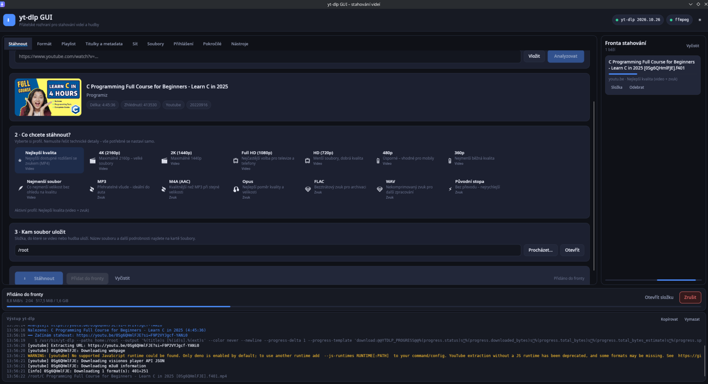
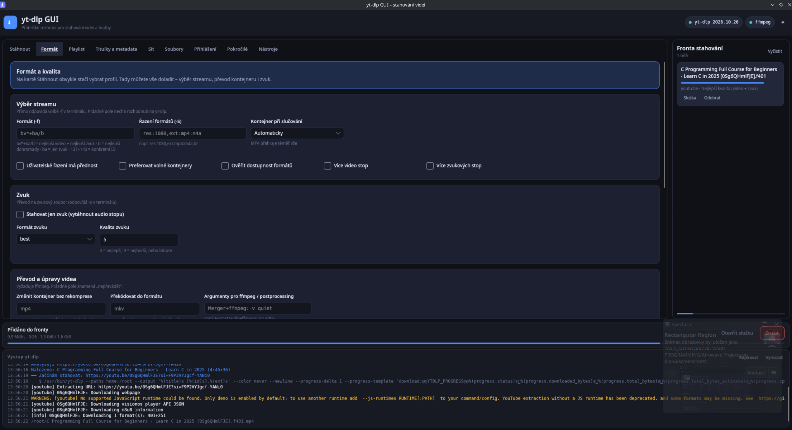
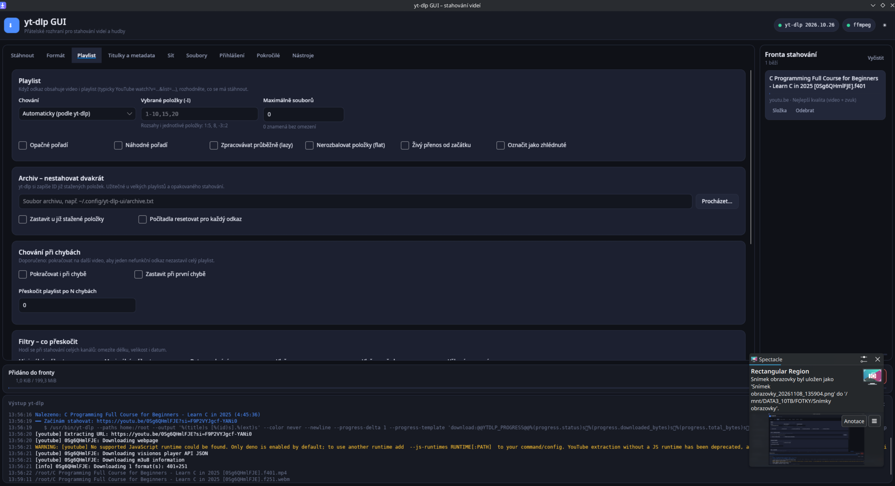
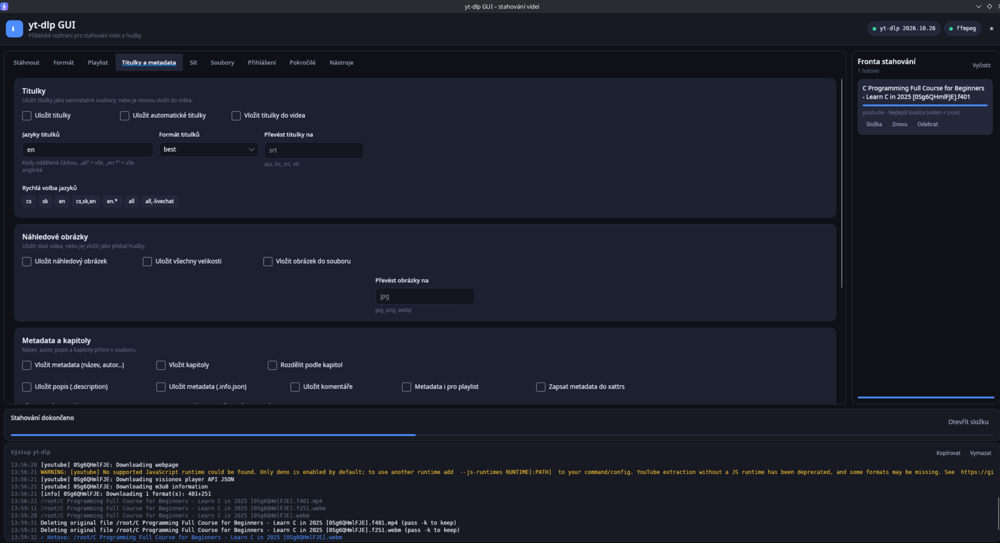
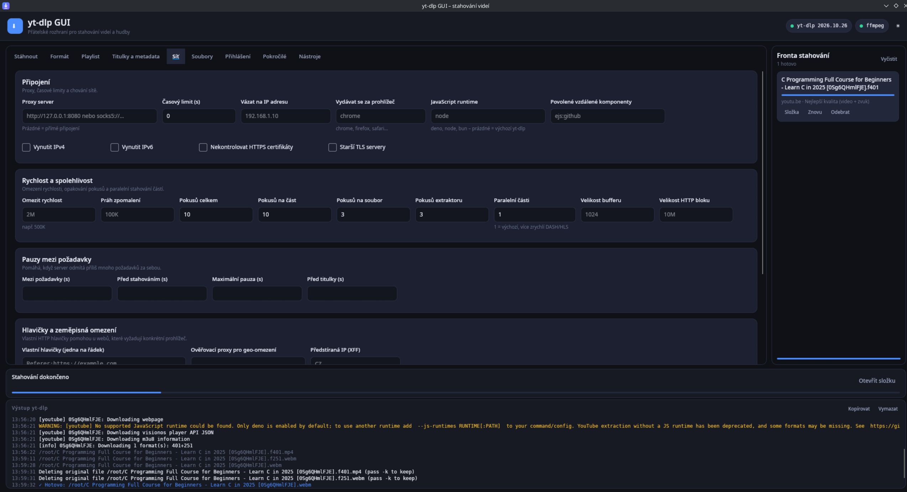
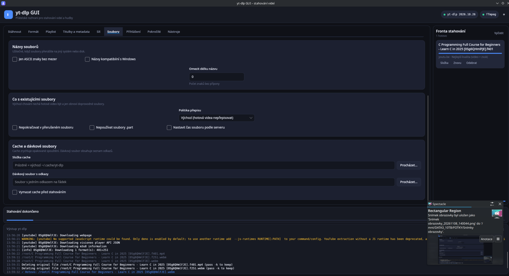
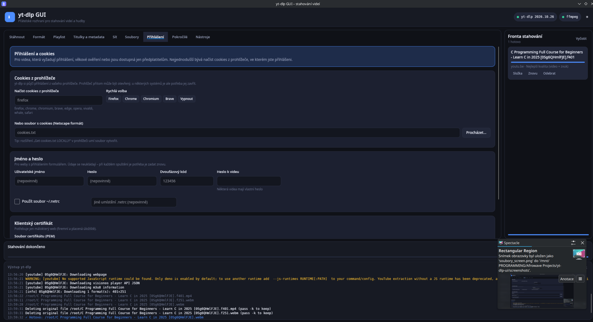
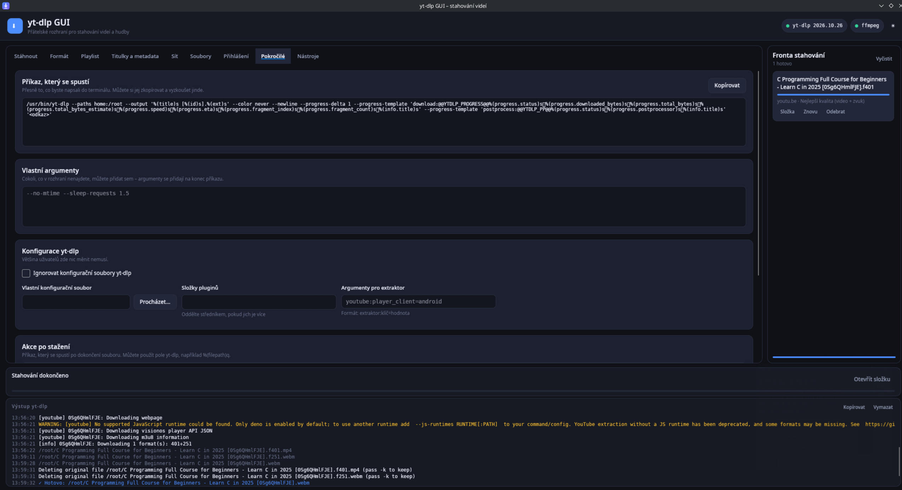
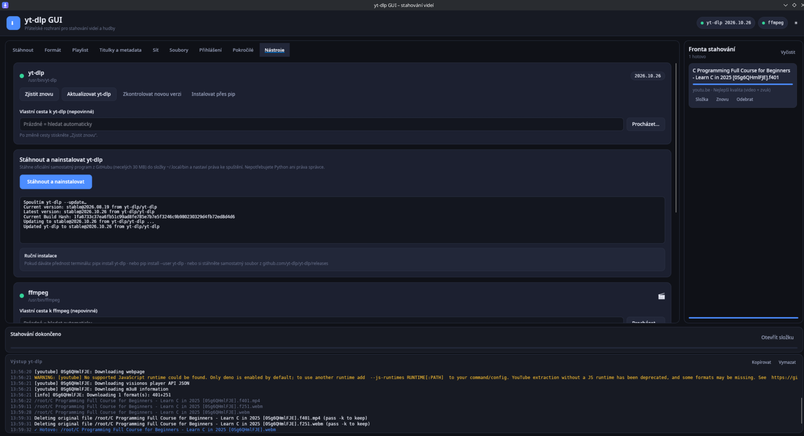

# yt-dlp GUI

A friendly **cross-platform desktop interface for [yt-dlp](https://github.com/yt-dlp/yt-dlp)**, built with [Avalonia UI](https://avaloniaui.net/) and .NET 10. Paste a video or playlist URL, choose a preset, and manage downloads without memorizing command-line options. Advanced yt-dlp options remain accessible when you need them.

**Release status:** **[v0.1.6 — maintenance pre-release](https://github.com/afrowaveltd/yt-dlp-ui/releases/tag/v0.1.6)** is available for Windows x64 and Linux x64. It is a community pre-release; feedback and bug reports are welcome.

**Documentation:** English (this page) · [Česky](../README/cs.md) · [Documentation index](../Documentation/en.md) · [Český rozcestník](../Documentation/cs.md)

## What you get

- **Simple downloads:** clipboard URL detection, drag-and-drop, video/playlist analysis, thumbnails, quality presets (up to 4K), audio-only choices, queue and progress.
- **Nine tabs:** Download, Format, Playlist, Subtitles & metadata, Network, Files, Authentication, Advanced and Tools.
- **Power-user options:** format selection, conversions, subtitles, metadata, filters, proxies, filename templates, authentication/cookies, and a copyable yt-dlp command preview.
- **External tools:** yt-dlp detection/update, FFmpeg detection and automatic Deno JavaScript runtime discovery; Windows setup offers independently selected, SHA-256-verified yt-dlp, FFmpeg and Deno installations.
- **Localization:** language selector in the upper-right header beside the tool status indicators. English/Czech dictionaries, automatic discovery of new `Locales/*.json` files, instant switching and English fallback.
- **Desktop packaging:** Windows x64 `setup.exe` and portable build; Linux `.deb`, `.rpm` and portable `.tar.gz`.

Some advanced tabs, runtime messages and dialogs still contain Czech text. **Localization remains partial in 0.1.6.** A built or packaged artifact is not proof that all installation and download scenarios have been manually tested.

## Fix in 0.1.6

- Fixed an issue where **playlist titles still appeared as the `MediaEntry` class name** despite the v0.1.5 template change.
- The explicit playlist item template is now unconditional. A human-readable fallback also includes the **position, video title and duration**, even if Avalonia uses default rendering.
- Added a **real headless Avalonia UI smoke test** that loads the compiled Download page and verifies its playlist text. Windows and Linux CI run this test.

[0.1.6 release notes](../Release-0.1.6/en.md) · [České poznámky](../Release-0.1.6/cs.md)

## Fix in 0.1.5

- Fixed the **playlist preview list** displaying `YtDlpUi.Core.Models.MediaEntry` instead of the videos' names.
- Each playlist entry now shows its **position, title and duration** (when known).
- Corrected the Avalonia `DataTemplate` model from `LogLine` to `MediaEntry` and added a regression smoke test.
- This is a **display-only correction**: playlist downloading, queue behavior and video format selection are unchanged.

[0.1.5 release notes](../Release-0.1.5/en.md) · [České poznámky](../Release-0.1.5/cs.md)

## Changes in 0.1.4

- Added a **third live status indicator for Deno** in the top-right header, alongside yt-dlp and FFmpeg. The tooltip shows its detected path.
- The **Tools → Deno** card now reports availability, version and path; it can recheck or **install a personal Deno copy on supported Windows/Linux systems** without administrator rights.
- On Linux, discovery includes `DENO_INSTALL/bin`, `~/.deno/bin` and other common user locations, even when a desktop launch does not inherit the interactive shell PATH.
- Added regression checks for the Deno controls and user-private installation path; the Windows Setup's optional shared Deno installation remains available.

[0.1.4 release notes](../Release-0.1.4/en.md) · [Deno/YouTube help](../Troubleshooting/en.md)

## Fixes in 0.1.3

- Fixed the recurring YouTube warning about missing JavaScript runtime support by automatically detecting a locally installed Deno executable for both analysis and downloads.
- The elevated Windows setup now offers a **third, independent, initially checked choice: Install Deno**. Deno is downloaded from its official releases, checked with SHA-256, validated and installed for all users alongside yt-dlp and FFmpeg.
- Advanced manual JavaScript-runtime settings and extra arguments still override automatic detection. The GUI never silently installs a runtime by itself.
- When installed from a standalone official yt-dlp EXE, its EJS scripts are already bundled; no separate EJS download is needed.

[0.1.3 release notes](../Release-0.1.3/en.md) · [Deno/YouTube help](../Troubleshooting/en.md)

## Fixes in 0.1.2

- Windows Setup now requests **UAC administrator approval** and installs the app machine-wide in Program Files.
- The optional yt-dlp and FFmpeg checkboxes install shared tools into `%ProgramData%\yt-dlp-ui\tools`, with publisher SHA-256 verification.
- Normal non-admin GUI sessions find the shared tools; language, cache and settings remain per-user.
- Tool installers verify executable startup and retain the previous executable if replacement fails.
- Previous per-user setup installations may need removal to avoid duplicate shortcuts.

[Full 0.1.2 notes](../Release-0.1.2/en.md) · [Previous 0.1.1 fixes](../Release-0.1.1/en.md)

## Fixes in 0.1.1

- Replaced the clipped globe emoji in the language picker with a vector icon and reserved spacing.
- Queued downloads now retain their own format, output and authentication options even when the UI changes.
- Standalone yt-dlp installs validate the exact published SHA-256 before replacing an existing executable.
- FFmpeg upgrades retain the previous installation until the new version is ready.
- Settings are written through an atomic rename; disabling option history clears previous snapshots.
- Active queue items cannot be silently removed; raw commands potentially containing credentials are no longer auto-logged.

Read the [English](../Release-0.1.3/en.md) / [Czech](../Release-0.1.3/cs.md) patch notes. **This desktop-only patch does not include the experimental Android application.**

## Screenshots

| | |
|---|---|
|  **Format** |  **Playlist** |
|  **Subtitles & metadata** |  **Network** |
|  **Files** |  **Authentication** |
|  **Advanced** |  **Tools** |

Screenshots illustrate the interface at the time they were captured; newer language and installer controls may differ. Click an image for its full size.

## Install or run

### Windows 10/11 (x64)

Download **the Windows setup EXE** from [v0.1.6](https://github.com/afrowaveltd/yt-dlp-ui/releases/tag/v0.1.6) and run `yt-dlp-gui-setup-0.1.6-win-x64.exe`. The installer creates Start-menu shortcuts, supports normal uninstall, and offers three **independent, initially selected** options: install yt-dlp, install FFmpeg, and install Deno (recommended for YouTube). Downloads require an internet connection and use publisher-provided SHA-256 checksums. You may clear any checkbox or install the tools later. Setup now **requests administrator approval (UAC)** and installs for all users under Program Files. If selected, yt-dlp, FFmpeg and Deno are placed in shared ProgramData and found automatically by the normally non-elevated GUI. Uninstall older per-user setup copies to avoid duplicate shortcuts; personal settings are preserved.

A **`yt-dlp-gui_0.1.6_win-x64_portable.zip`** portable build is also available in the release. Windows ARM64 has a separate manual publish command, but is **not** covered by the CI installer.

### Debian / Ubuntu, Fedora / openSUSE, other Linux

Download the matching **DEB or RPM** from [v0.1.6](https://github.com/afrowaveltd/yt-dlp-ui/releases/tag/v0.1.6), then use your distribution's package manager:

~~~bash
sudo apt install ./yt-dlp-gui_0.1.6_amd64.deb    # Debian/Ubuntu x64
sudo dnf install ./yt-dlp-gui-0.1.6-1.x86_64.rpm # Fedora-style RPM
~~~

Package filenames depend on version and architecture. DEB/RPM **recommend** `yt-dlp` and `ffmpeg` but do not bundle them or run hidden download scripts. Package-manager behavior differs by distribution. For other Linux systems, unpack the portable `tar.gz` and run `./yt-dlp-gui/yt-dlp-gui`. An existing compatible .NET runtime is **not** required by the self-contained builds.

For a per-user Linux installation from source, run `./scripts/install.sh`; for removal, `./scripts/install.sh --uninstall`.

**v0.1.6 is a published, unsigned pre-release.** See [Installation](../Installation/en.md) for exact build commands, dependencies and platform limitations.

## Build from source

Install the **.NET 10 SDK** (see `global.json`) and clone the repository:

~~~bash
git clone https://github.com/afrowaveltd/yt-dlp-ui.git
cd yt-dlp-ui
dotnet restore YtDlpUi.slnx
dotnet build YtDlpUi.slnx -c Release
dotnet run --project src/YtDlpUi/YtDlpUi.csproj
dotnet run --project tests/YtDlpUi.SmokeTests/YtDlpUi.SmokeTests.csproj -c Release
~~~

`yt-dlp` is required to download; `ffmpeg` / `ffprobe` are needed for merging and many conversion workflows. Use the **Tools** tab to check their status or choose custom paths.

## Localization in one minute

The language selector is in the **top-right header** next to the yt-dlp, FFmpeg and Deno indicators. Choose your language and it updates already localized controls immediately.

To add a translation without rebuilding, create a JSON dictionary such as `pt-BR.json` in:

- Linux: `~/.config/yt-dlp-ui/Locales/` (or `$XDG_CONFIG_HOME/yt-dlp-ui/Locales/`)
- Windows: `%LOCALAPPDATA%\yt-dlp-ui\Locales\`
- Alternatively: `Locales/` next to the application executable

~~~json
{
  "Download": "Baixar",
  "About": "Sobre"
}
~~~

Reopen the language selector to rescan files. Filenames are culture codes (e.g. `fr.json`, `pt-BR.json`); keys are English UI strings. Missing or empty translations fall back to the English key. Custom dictionaries take precedence over bundled ones. More: [Localization](../Localization/en.md).

## Documentation

| Topic | English | Česky |
|---|---|---|
| Documentation index | [Index](../Documentation/en.md) | [Rozcestník](../Documentation/cs.md) |
| Getting started | [Guide](../Getting-Started/en.md) | [Průvodce](../Getting-Started/cs.md) |
| Installation and packages | [Install](../Installation/en.md) | [Instalace](../Installation/cs.md) |
| Features and workflow | [Features](../Features/en.md) | [Funkce](../Features/cs.md) |
| Localization | [Locales](../Localization/en.md) | [Jazyky](../Localization/cs.md) |
| Configuration and storage | [Settings](../Configuration/en.md) | [Nastavení](../Configuration/cs.md) |
| Troubleshooting | [Help](../Troubleshooting/en.md) | [Řešení problémů](../Troubleshooting/cs.md) |
| Development and verification | [Development](../Development-and-Verification/en.md) | [Vývoj](../Development-and-Verification/cs.md) |
| Versioning and release policy | [Versioning](../Versioning/en.md) | [Verzování](../Versioning/cs.md) |
| Android prototype (experimental) | [Android](../Android/en.md) | [Android](../Android/cs.md) |
| Patch 0.1.6 | [Release notes](../Release-0.1.6/en.md) | [Opravy](../Release-0.1.6/cs.md) |
| Patch 0.1.5 | [Release notes](../Release-0.1.5/en.md) | [Opravy](../Release-0.1.5/cs.md) |
| Patch 0.1.4 | [Release notes](../Release-0.1.4/en.md) | [Opravy](../Release-0.1.4/cs.md) |
| Patch 0.1.3 | [Release notes](../Release-0.1.3/en.md) | [Opravy](../Release-0.1.3/cs.md) |
| Previous patch 0.1.1 | [History](../Release-0.1.1/en.md) | [Historie](../Release-0.1.1/cs.md) |

## License, privacy and attribution

The **GUI source code** is licensed under [MIT](../../LICENSE). [yt-dlp](https://github.com/yt-dlp/yt-dlp), [FFmpeg](https://ffmpeg.org/) and [Deno](https://deno.com/) are separate third-party projects with their **own licenses**; installing their binaries does not change the GUI license. No application telemetry or ads are included. Metadata lookup, downloads, dependency setup and update checks can still contact their respective online services when requested or enabled.

Remembered download options deliberately omit supported password and 2FA fields. Treat downloaded files, cookies and logs according to your own privacy needs. Download only media you are authorized to access and respect site terms.

**[v0.1.6 is published](https://github.com/afrowaveltd/yt-dlp-ui/releases/tag/v0.1.6)** as a maintenance pre-release. See [release status and outstanding tests](../Release-0.1.6/en.md).
