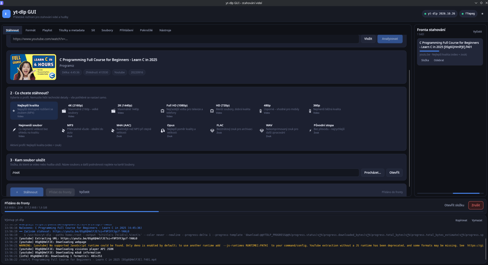
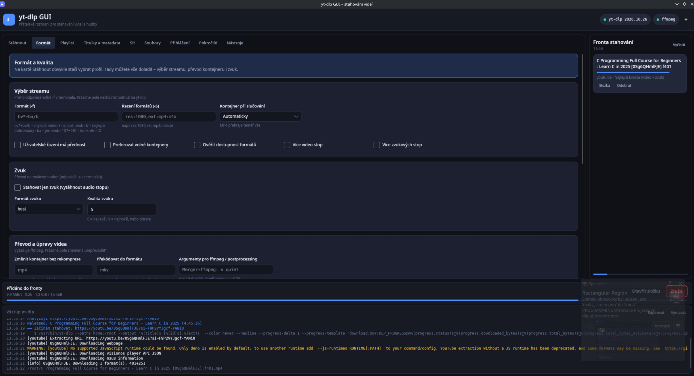
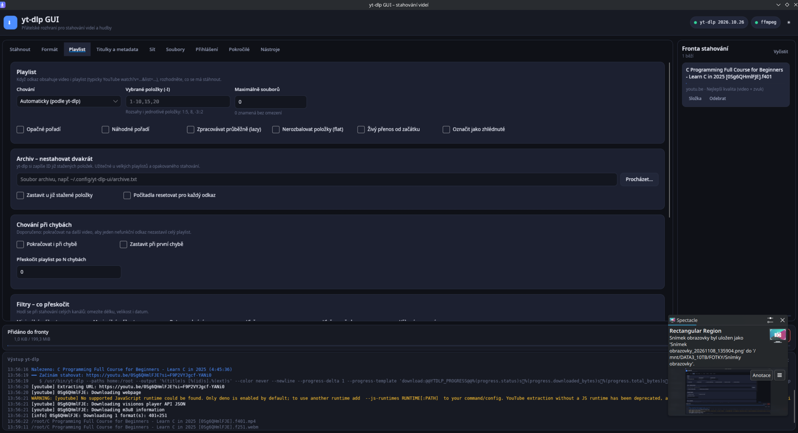
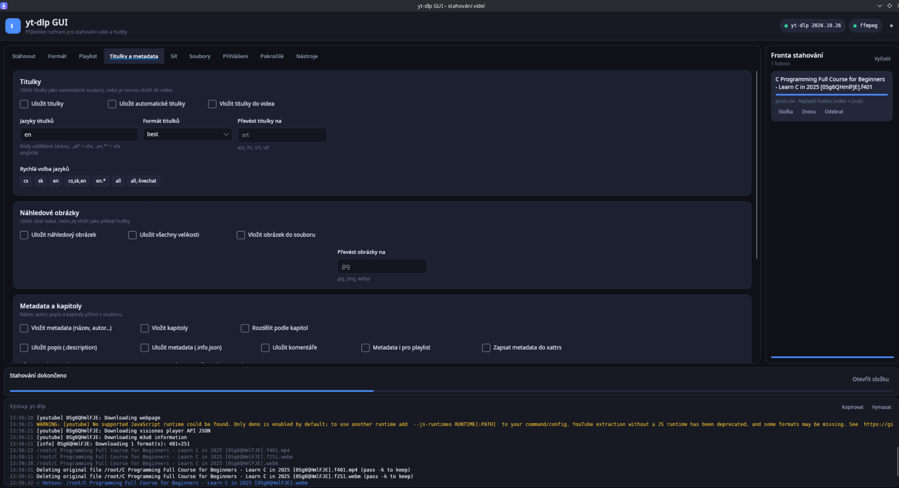
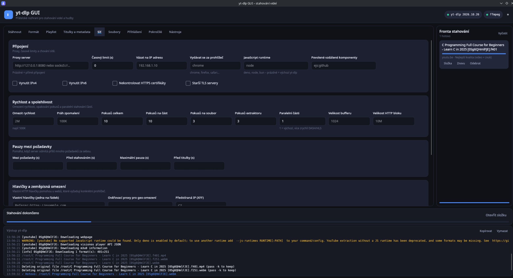
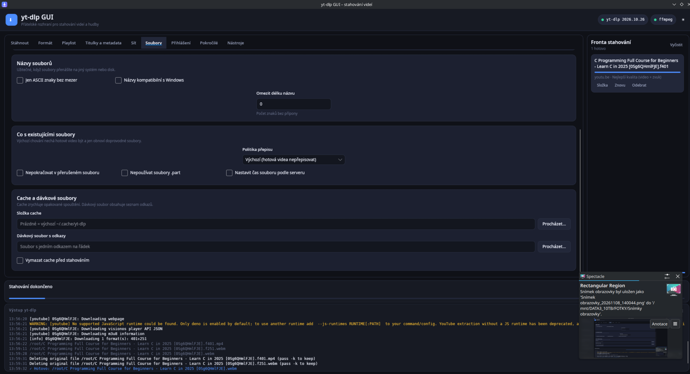
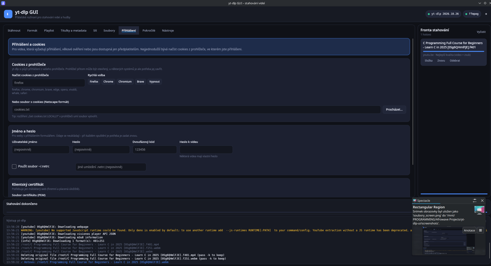
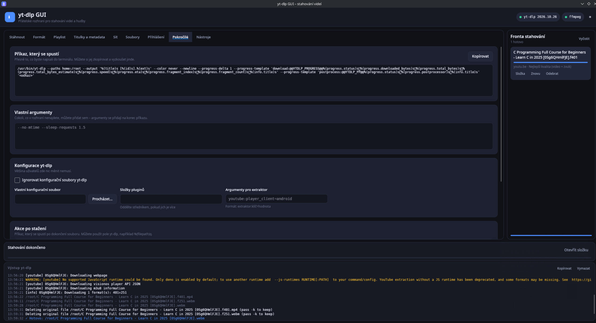
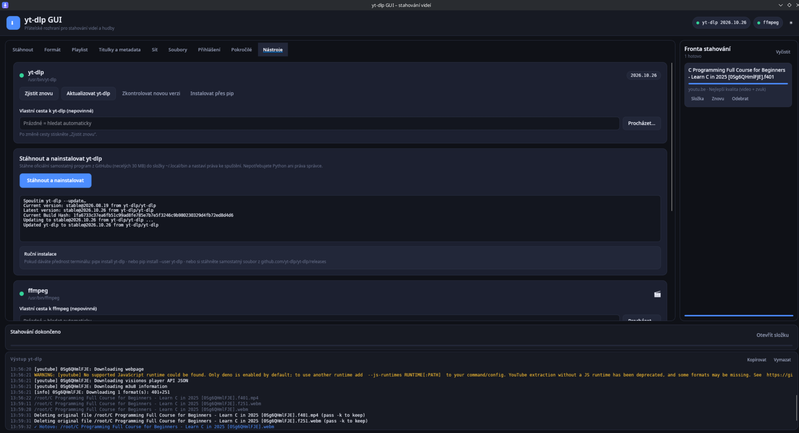

# yt-dlp GUI

Přátelské grafické rozhraní pro [yt-dlp](https://github.com/yt-dlp/yt-dlp) na Linuxu (ale poběží i na Windows
a macOS). Cílem je, aby video nebo hudbu zvládl stáhnout i někdo, kdo nikdy nepoužil terminál – a přitom aby
v rozhraní našel téměř všechny volby, které yt-dlp nabízí.

Postaveno na [Avalonia UI](https://avaloniaui.net/) (.NET 10) – jde o skutečnou desktopovou aplikaci,
ne o webovou stránku v prohlížeči.

## Ukázky

Hlavní obrazovka – odkaz se naplní ze schránky, aplikace ukáže náhled videa a vy jen vyberete profil:

<a href="screenshots/main_screen.png"></a>

Zbývajících osm karet pro jemnější nastavení:

<table>
  <tr>
    <td width="50%" align="center" valign="top">
      <a href="screenshots/format_screen.png"></a>
      <br><sub><b>Formát</b> – výběr streamu, převody, střih a tabulka dostupných formátů</sub>
    </td>
    <td width="50%" align="center" valign="top">
      <a href="screenshots/playlist_screen.png"></a>
      <br><sub><b>Playlist</b> – rozsahy položek, archiv, filtry a chování při chybách</sub>
    </td>
  </tr>
  <tr>
    <td width="50%" align="center" valign="top">
      <a href="screenshots/titulky_screen.png"></a>
      <br><sub><b>Titulky a metadata</b> – titulky, obaly, kapitoly i SponsorBlock</sub>
    </td>
    <td width="50%" align="center" valign="top">
      <a href="screenshots/sit_screen.png"></a>
      <br><sub><b>Síť</b> – proxy, limity rychlosti, opakování a hlavičky</sub>
    </td>
  </tr>
  <tr>
    <td width="50%" align="center" valign="top">
      <a href="screenshots/soubory_screen.png"></a>
      <br><sub><b>Soubory</b> – šablona názvu, přepisování a cache</sub>
    </td>
    <td width="50%" align="center" valign="top">
      <a href="screenshots/prihlaseni_screen.png"></a>
      <br><sub><b>Přihlášení</b> – cookies z prohlížeče, údaje a certifikáty</sub>
    </td>
  </tr>
  <tr>
    <td width="50%" align="center" valign="top">
      <a href="screenshots/pokrocile_screen.png"></a>
      <br><sub><b>Pokročilé</b> – náhled přesného příkazu a vlastní argumenty</sub>
    </td>
    <td width="50%" align="center" valign="top">
      <a href="screenshots/nastroje_screen.png"></a>
      <br><sub><b>Nástroje</b> – instalace a aktualizace yt-dlp, ffmpeg, nastavení</sub>
    </td>
  </tr>
</table>

<sub>Screenshoty jsou z tmavého motivu. Světlý režim zapnete tlačítkem ☀ vpravo nahoře nebo přepínačem
na kartě <b>Nástroje</b>. Kliknutím na obrázek se otevře v plném rozlišení.</sub>

## Co aplikace umí

**Pro začátečníky**

- Odkaz se **sám naplní ze schránky**, jakmile si jej někam zkopírujete – stačí otevřít aplikaci.
- Tlačítko **Analyzovat** ukáže název, autora, délku, obal videa i seznam dostupných formátů.
- Místo technických zkratek si vyberete **hotový profil**: nejlepší kvalita, 4K, Full HD, 720p nebo jen zvuk
  (MP3, M4A, Opus, FLAC, WAV).
- **Fronta stahování** – přidávejte odkazy průběžně, aplikace je stahuje jeden po druhém.
- Živý **průběh**: procenta, rychlost, zbývající čas, velikost.
- Srozumitelné **chybové zprávy** v češtině místo surového výstupu yt-dlp.
- Pokud yt-dlp v systému chybí, aplikace jej **nabídne stáhnout a nainstalovat** jedním kliknutím.
- Přetažení odkazu z prohlížeče přímo do okna také funguje.

**Pro pokročilé**

Devět karet pokrývá prakticky celý `yt-dlp --help`:

| Karta | Co obsahuje |
| --- | --- |
| **Stáhnout** | odkaz, analýza, profily kvality, cílová složka, spuštění |
| **Formát** | `-f`, `-S`, kontejner při slučování, multistream, extrakce zvuku, převod/remux, střih (`--download-sections`), tabulka dostupných formátů |
| **Playlist** | chování playlistu, `-I` rozsahy, pořadí, archiv (`--download-archive`), limity, filtry (velikost, datum, `--match-filters`), živé přenosy |
| **Titulky a metadata** | titulky a jejich jazyky/formáty, vkládání do videa, obaly, metadata, kapitoly, SponsorBlock |
| **Síť** | proxy, časové limity, IPv4/IPv6, limit rychlosti, opakování, paralelní části, hlavičky, geo-omezení, externí stahovač (aria2c…) |
| **Soubory** | šablona názvu (`-o`) s rychlými předvolbami, dočasná složka, ASCII/Win názvy, politika přepisu, cache, dávkový soubor |
| **Přihlášení** | cookies z prohlížeče, soubor cookies, jméno/heslo, 2FA, `.netrc`, klientský certifikát |
| **Pokročilé** | náhled přesného příkazu, vlastní argumenty, konfigurace yt-dlp, diagnostika, obnovení výchozích hodnot |
| **Nástroje** | stav a instalace yt-dlp, aktualizace, ffmpeg, nastavení aplikace |

**Náhled příkazu.** Na kartě *Pokročilé* je vždy vidět přesný příkaz, který se spustí – můžete si jej
zkopírovat a naučit se tak pracovat s yt-dlp v terminálu.

**Co v rozhraní není?** Velmi vzácné volby (Adobe Pass `--ap-*`, `--alias`, `--compat-options`, simulace
`-s`) – ty lze vložit do pole **Vlastní argumenty**, které se přidá na konec příkazu.

## Požadavky

- **yt-dlp** – pokud chybí, aplikace jej nabídne nainstalovat (karta *Nástroje*).
- **ffmpeg** – potřeba pro slučování videa se zvukem a pro převod do MP3/MP4. Nainstalujte z vašeho
  správce balíčků, např. `sudo apt install ffmpeg`, `sudo dnf install ffmpeg`, `sudo pacman -S ffmpeg`.

Pro běh ze zdrojových kódů dále **.NET SDK 10**.

## Rychlý start

```bash
git clone <repo> yt-dlp-ui && cd yt-dlp-ui

# 1) sestavení
dotnet build YtDlpUi.slnx

# 2) spuštění
dotnet run --project src/YtDlpUi/YtDlpUi.csproj
```

Nebo si vytvořte sestavení, které nepotřebuje .NET v systému:

```bash
./scripts/build.sh               # složka aplikace -> publish/
./publish/yt-dlp-gui

./scripts/build.sh --single-file # jeden přenosný soubor -> publish/yt-dlp-gui
```

Výchozí je složka aplikace, protože je spolehlivější: jednosouborové sestavení si při startu musí
rozbalit nativní knihovny do cache adresáře a na systémech s domovským adresářem jen pro čtení
(vzdálené servery, kontejnery) selže.

## Instalace do systému

```bash
./scripts/install.sh
```

Skript aplikaci sestaví a nainstaluje do `~/.local/opt/yt-dlp-gui`, vytvoří příkaz `~/.local/bin/yt-dlp-gui`
a položku v nabídce aplikací (`~/.local/share/applications/yt-dlp-gui.desktop`) včetně ikony.
Práva správce nejsou potřeba. Odinstalace: `./scripts/install.sh --uninstall`.

Předpokladem je, že `~/.local/bin` máte v `PATH` (na většině distribucí bývá).

## Jak aplikaci používat

1. Zkopírujte si odkaz na video kdekoliv (v prohlížeči, v aplikaci…).
2. Otevřete yt-dlp GUI – odkaz se sám objeví v poli *Odkaz na video* a rovnou se analyzuje.
3. Vyberte profil (např. *Full HD (1080p)* nebo *Jen zvuk – MP3*).
4. Zkontrolujte složku, kam se má soubor uložit.
5. Stiskněte **Stáhnout**.

Hotový soubor otevřete tlačítkem **Otevřít složku**.

### Klávesové zkratky

| Zkratka | Akce |
| --- | --- |
| `Ctrl+L` | skočit do pole s odkazem |
| `F5` | analyzovat odkaz |
| `Ctrl+Enter` | stáhnout |

## Kde se co ukládá

| Co | Kde |
| --- | --- |
| Nastavení aplikace a poslední volby | `~/.config/yt-dlp-ui/settings.json` |
| Stažené soubory | výchozí složka *Stažené* (zjistí se z `user-dirs.dirs`), lze změnit |
| yt-dlp nainstalované aplikací | `~/.local/bin/yt-dlp` |

Hesla a 2FA kódy se **nikdy neukládají** na disk.

## Řešení problémů

- **„yt-dlp není nainstalováno“** – otevřete kartu *Nástroje* a stiskněte *Stáhnout a nainstalovat*.
  Případně nainstalujte z terminálu: `pipx install yt-dlp`.
- **„Nelze sloučit video a zvuk“** – chybí ffmpeg. Nainstalujte jej (viz *Požadavky*).
- **Video vyžaduje přihlášení** – karta *Přihlášení* → *Načíst cookies z prohlížeče* → vyberte prohlížeč,
  ve kterém jste přihlášeni.
- **Něco nefunguje a nevím proč** – karta *Pokročilé* → zapněte *Podrobný výstup (verbose)*, zopakujte akci
  a podívejte se do logu ve spodní části okna. Tlačítkem *Kopírovat* jej snadno přenesete jinam.
- **Aplikace se nespustí na virtuálním stroji** – zkuste `YTDLP_GUI_SOFTWARE_RENDER=1 ./publish/yt-dlp-gui`
  (vypne hardwarové vykreslování OpenGL).
- **Chci vidět, proč se něco chová divně** – `YTDLP_GUI_TRACE=1` vypíše do terminálu varování Avalonia UI.
- **Jednosouborové sestavení hlásí `Failed to determine location for extracting embedded files`** –
  nastavte zapisovatelný adresář: `DOTNET_BUNDLE_EXTRACT_BASE_DIR=/tmp/dotnet ./publish/yt-dlp-gui`,
  nebo použijte výchozí (složkové) sestavení.

## Struktura projektu

```
src/
  YtDlpUi.Core/          # vše bez UI – testovatelné samostatně
    Models/              # DownloadOptions (všechny volby), MediaInfo, AppSettings
    Services/            # YtDlpArgumentBuilder, DownloadEngine, ProgressParser,
                         # MetadataService, ToolLocator, YtDlpInstaller, SettingsStore
  YtDlpUi/               # Avalonia UI
    Views/               # MainWindow + jedna stránka na každou kartu
    ViewModels/          # MainWindowViewModel, ToolchainViewModel, DownloadItemViewModel
    Converters/, Styles/ # převodníky a vizuální styl
scripts/                 # build.sh, install.sh
packaging/               # položka nabídky aplikací
```

Klíčové místo pro přidání další volby yt-dlp:

1. vlastnost v `DownloadOptions`,
2. její namapování na přepínač v `YtDlpArgumentBuilder`,
3. ovládací prvek v příslušné stránce.

## Vývoj

```bash
dotnet build YtDlpUi.slnx
dotnet run --project src/YtDlpUi/YtDlpUi.csproj
```

### Když `dotnet` hlásí „Read-only file system“

Pokud jsou `~/.nuget` nebo `~/.dotnet` jen pro čtení, použijte přiložený pomocný skript, který
přesune cache do složky projektu:

```bash
source ./.local-build-env.sh
dotnet build YtDlpUi.slnx
```

Poznámka: projekt záměrně **nevypíná** trimming při publikaci (`PublishTrimmed=false`), protože vazby
v XAML jsou reflexní a ořez by je rozbil. Kompilované vazby (`x:DataType`) by šly zapnout, ale přidaly by
velké množství boilerplate do devíti stránek.

## Licence a poděkování

Aplikace je pouze rozhraní – veškerou práci odvádí [yt-dlp](https://github.com/yt-dlp/yt-dlp) a
[ffmpeg](https://ffmpeg.org/). Respektujte prosím autorská práva a podmínky služeb jednotlivých webů;
stahujte jen obsah, ke kterému máte právo.
